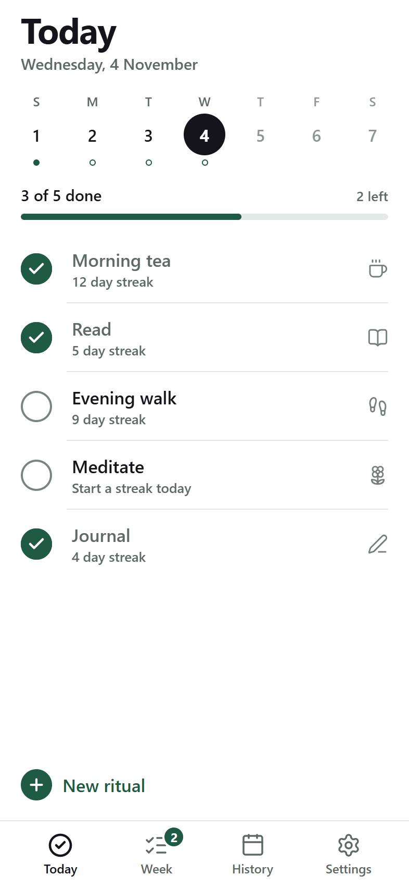
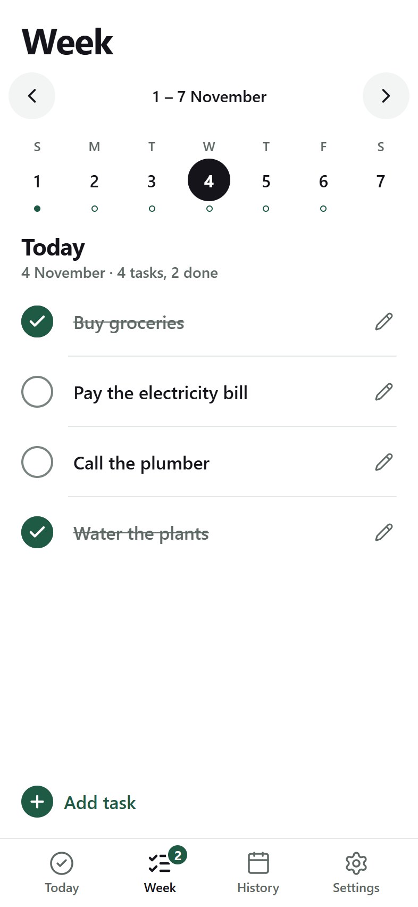
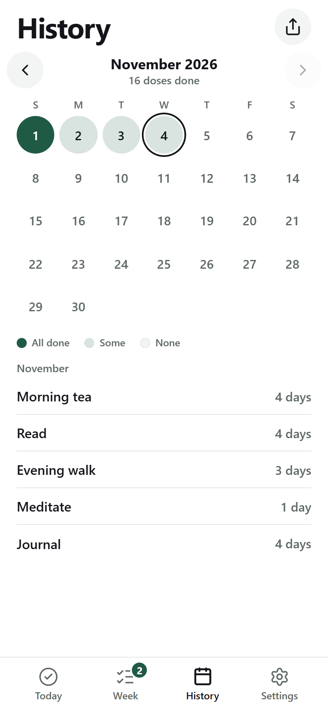
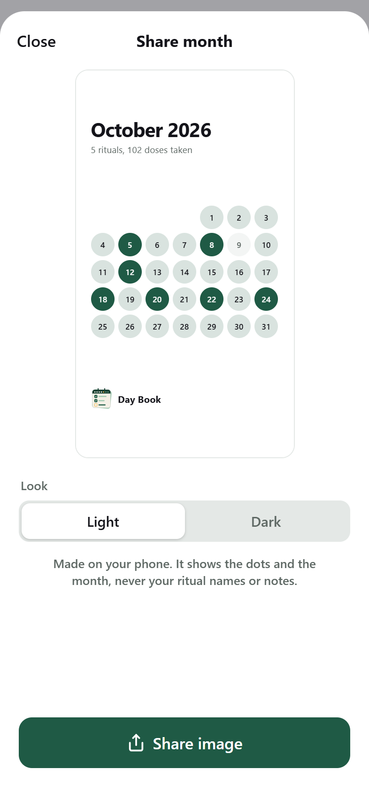
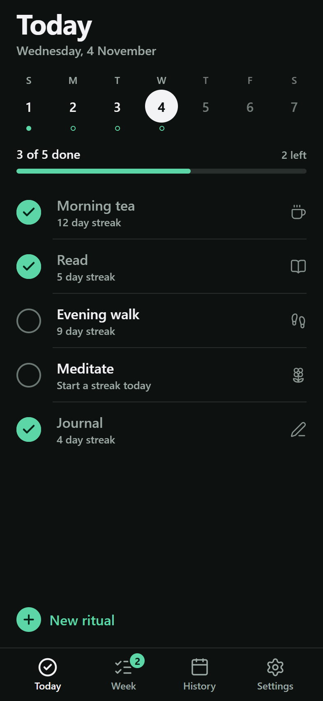

# Day Book

A small, free habit tracker and weekly task list for Android. You list the things you want to do each day, press a circle when you've done one, and watch the month fill in.

No account. No ads. No subscription. Your habits stay on your phone.

**Version 2.0.0**

| Today | Week | History | Share your month | Dark |
|---|---|---|---|---|
|  |  |  |  |  |

The pictures use sample data.

## Why I built it

I used to track my habits in a web app on my PC, and it worked until I wasn't at my desk. The habit apps for phones were mostly paid, limited, or full of ads. I wanted one that is simple, free and keeps its data on my own phone, so I built it.

## What it does

- **Rituals.** Small things you do every day, each with a name, an icon and an optional note. Edit or delete one any time.
- **One tap a day.** On the Today screen, press a ritual's circle when it's done. Press again to undo.
- **Streaks.** See how many days in a row you've kept each ritual.
- **Fixing a day.** Forgot to tick something? You can still change yesterday. Older days are kept as a record you can look at but not change.
- **Week.** Tasks that belong to one day. Pick a day and tap Add task, and press and hold a task to move it to another day.
- **History.** Every day on a calendar, with month arrows. A filled circle means you did every ritual that day.
- **Reminders.** A ritual reminder if rituals are still open, and a task reminder on days that have tasks. Both are off until you turn them on in Settings, where you also set the times. They only carry counts, never your task or ritual names.
- **Light and dark.** Choose one, or follow your phone's setting.
- **Haptics.** Small taps when you tick, move a task or save. You can turn them off.
- **Backup and restore.** Save everything to one file through your phone's share sheet, and restore it on a new phone.
- **Share your month.** Make a picture of your month's circles to post. It never shows your ritual names or notes.
- **Tablets.** On a large screen, lists and details sit side by side, and Week becomes a seven-day board.

## Install

Android only.

1. Open the [latest release](../../releases/latest) on your phone.
2. Download the `.apk` file and open it.
3. Android will ask you to allow installs from this source. Allow it and tap **Install**.

Android may warn that the app comes from an unknown developer. That is because it isn't on the Play Store.

**Coming from 1.0.0?** Install over it and your rituals and history stay. Save a backup first, to be safe.

## Your data

Everything is stored on your phone. There is no server, no sign-in and the app sends nothing anywhere. Use **Settings, then Save a backup** to keep a copy you control. Backup files are plain text, so keep them somewhere private. Uninstalling the app removes its data, so save a backup first.

If your phone's own Android backup is on, Android may include the app's data in the backup it keeps in your Google account.

## Run it from source

Built with Expo and React Native.

```bash
npm install
npx expo start
```

Open it in Expo Go, or press `w` for the web version. Reminders only work in the installed app, not in Expo Go or a browser.

```bash
npm test          # logic tests
npx tsc --noEmit  # types
npx expo lint     # lint
```

To build an installable Android file with [EAS](https://docs.expo.dev/build/introduction/), run `eas build --platform android --profile preview`.

## Built with

Expo SDK 57, React Native, Expo Router, Reanimated, TypeScript, and AsyncStorage for local storage.

## License

[MIT](LICENSE)
